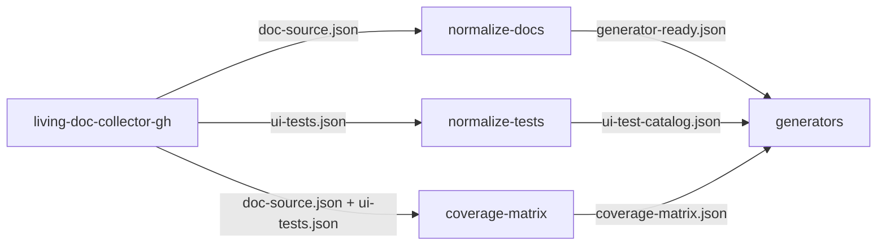

# Living Documentation Toolkit

## Purpose

Python monorepo behind one CLI (`living-doc`) and one composite GitHub Action. It sits between the `living-doc-*`
collectors and the generators: it reads collector output as `living-doc-utilities` contract artifacts, validates a
command's inputs together, and writes the contract a generator reads.

- Commands: `normalize-docs`, `normalize-tests`, `coverage-matrix`.
- Not responsible for: collecting (collectors), rendering (generators), contract models and schemas
  (`living-doc-utilities`).
- AI-free: deterministic Python only, no LLM and no network call in the pipeline (`CONTRIBUTING.md` § AI-free
  Principle).

## Tech stack

- Python `>=3.10`; CI runs 3.10 to 3.14.
- `living-doc-utilities==0.8.0`: the contract models (pydantic 2), schemas, `read_artifact` / `write_artifact`,
  lineage and stats helpers.
- `click` for the CLI; a bash composite action that builds its own venv (`action.yml`).
- pytest + pytest-cov, ruff, Black, Pylint, mypy, deptry.

## Structure

| Path | What it is |
|---|---|
| `packages/core/` | `living-doc-core`: logging, reader table, shared input validation, view filter, run context, envelope helpers ([README](packages/core/README.md)) |
| `packages/services/` | One package per command: builder, lineage table, command ([CONTEXT](packages/services/CONTEXT.md)) |
| `apps/cli/` | `living-doc-cli`: the click group and one module per command under `commands/` ([README](apps/cli/README.md)) |
| `main.py`, `action.yml` | The action: `action.yml` builds the venv, `main.py` checks `INPUT_*` and runs `living-doc <command>` with `-I` |
| `local-integration.sh`, `tools/` | The operator's run of the three commands outside any workflow; `tools/local_integration.py` validates and reports each output |
| `tests/` | The root tests (`test_main.py`, `test_action_yml.py`, `test_local_integration.py`), the page checks in `tests/docs/`, and the one fixture copy under `tests/fixtures/` |
| `.github/workflows/` | `test.yml` runs the `make` targets, the tests also on a page-only change (`docs_changed`); `integration.yml` runs the action through `uses: ./` |
| `README.md`, `docs/action.md` | The entry page; the action's full reference (inputs, commands, output, run-level errors) |
| `DEVELOPER.md`, `CONTRIBUTING.md`, `SPEC.md` | Solo pages: development, contribution conventions, the spec process with its pending list |

## How it fits together

- Each command: `validate_inputs` → builder → `metadata.run = run_context()` → `check_no_field_loss` →
  `write_artifact`. Nothing is written when a step fails.
- The CLI calls the service; the action calls the CLI. `--fail-under` is the CLI's gate, after the write.

## Domain

- Entities: User Story (`US-<n>`), Feature, Functionality (`FUNC-<n>`), each with acceptance criteria
  (`<entity_id>-<n>`, pattern `^(?:US|FUNC)-\d+-\d+$`).
- Criterion states: `active`, `deprecated`, `planned`, `in_review`. Coverage counts `active` and `deprecated` only.
- A criterion may declare variants: `Aspect:` values or one keyword, both stored in `aspect[]`; a keyword's name is
  the one `placeholder_values` key.
- Scenarios link criteria with `@AC:<id>` or `@AC:<id>/<param>:<value>` tags, stored as `AcLink(id, aspect)`.
- Views: `inner` keeps every record; `release` drops `planned` and `in_review` ones (`living_doc_core.views`).

## Contracts

All owned by `living-doc-utilities`; this repo defines none and commits no schema.

| Command | Reads | Writes |
|---|---|---|
| `normalize-docs` | `doc-source-v1.0.0` | `generator-ready-v1.0.0` |
| `normalize-tests` | `ui-tests-v1.0.0` | `ui-test-catalog-v1.0.0` |
| `coverage-matrix` | `doc-source-v1.0.0`, `ui-tests-v1.0.0` | `coverage-matrix-v1.0.0` |

- The canon: `living-doc-utilities` `docs/contracts/` (rendering, errors, artifact rules, component checks) and
  `docs/authoring/`; `living-doc` `docs/guides/`. Each package README links the sections it implements.
- Codes and warning fields: `living-doc-utilities` `docs/contracts/errors.md`.

## Running it

- Commands: `AGENTS.md` § This project (`make install`, `make qa`, `make test-<alias>`).
- `PYTHON` passed to `make` must be an absolute path (unverified).
- The action's entry point: `python3 main.py` with `INPUT_*` variables; `metadata.run` reads `GITHUB_RUN_ID`,
  `GITHUB_RUN_ATTEMPT`, `GITHUB_ACTOR`, `GITHUB_WORKFLOW`, `GITHUB_REF`, `GITHUB_SHA`.
- `./local-integration.sh [--check]`: the three commands through `main.py` over `.env.local`'s `DOC_INPUT` and
  `TESTS_INPUT`, in `.venv-local-integration/` built from `requirements.txt` alone, into `$OUT_DIR/toolkit/`; then
  `python -m tools.local_integration report` re-reads each output and fails on an input warning not forwarded
  unchanged (`DEVELOPER.md` § Local Integration Run). No workflow runs it.

## Conventions

- Pages follow `DEVELOPER.md` § Writing documentation, their only copy; `tests/docs/pages.py::APPROVED_PAGES` lists
  them, and a new page goes there and is linked from `README.md`. The READMEs beside test data are not pages.
- A page states facts without `path::symbol`; the `CONTEXT.md` beside the code maps them in `## Code map`
  (`tests/docs/pages.py::CODE_MAPS`). A changed fact updates both.
- Log through `living_doc_core.logging_config.setup_logging`, never `print`; lazy `%` formatting, no f-string in a
  logging call.
- Imports at module top; type hints on new public functions; 3.10 syntax, a 3.11+ standard-library use behind a
  `sys.version_info` fallback.
- No inline linter disable, except `too-many-arguments,too-many-positional-arguments` on a click command function
  (click passes each option as one parameter) and `no-value-for-parameter` on the `cli()` call in
  `apps/cli/src/living_doc_cli/main.py`.
- CLI arguments are parsed only in `apps/cli`'s command layer; builders stay pure, with no I/O or environment read.
- Tests use `pytest`, never `unittest`, in each package's own `tests/`, mirroring its `src/`.
- No error line, log text or exit code changes without a stated reason; the tests assert them exactly.
- Read a contract only through `living_doc_core.readers`, validate only through `validate_inputs`, write only through
  `write_artifact`.
- Every package is version `0.1.0` and pins the same `living-doc-utilities`; `metadata.producer.version` comes from
  the installed `living-doc-core`, never a literal.
- `SPEC.md` content moves to the live docs in the PR that ships it (`.claude/rules/docs-lifecycle.md`).

## Key decisions

- No contract models or schemas here (R12); `make no-vendored-schemas` fails on a committed `*-schema.json`.
- Each command's lineage table is declared in its own package and checked by `assert_complete` in tests only, so a
  field a later contract adds fails the tests, not a user's run.
- Shared input validation stops at the first failing step and reports every occurrence of it
  ([core README](packages/core/README.md#shared-input-validation)).

## Invariants and gotchas

- `tests/fixtures/collector-gh/` is the one fixture copy every package, the root tests and `integration.yml` read;
  refresh it as its [README](tests/fixtures/collector-gh/README.md) says.
- Each service's golden lives in its `tests/expected/`, with a README saying how to regenerate it; a change to the
  fixture pair's numbers also touches the CLI tests, `tests/test_main.py` and `integration.yml`.
- `make lint` reads `git ls-files`: `git add` a new file before linting it.
- `main.py`'s input checks run in a fixed order, and `tests/test_main.py` asserts its one-line errors exactly.
- `tests/test_action_yml.py`'s bash tests fail on Windows only; CI runs them on ubuntu (unverified).
- `tests/test_local_integration.py` runs the real script in a copy whose venv is pre-seeded with the test's own
  interpreter, so no test installs from the network; `.env.local.example`'s keys must equal the script's `KEYS`.
- `.local_context/` is private and never committed.

## Code map

What realises each fact of [`docs/action.md`](docs/action.md), the action's reference:

- Python 3.10 or later on `PATH`, checked before anything is created → `action.yml::sys.version_info`
- The action's own venv under `$RUNNER_TEMP` → `action.yml::living-doc-toolkit-venv`
- Each run installs `requirements.txt` with `pip` → `action.yml::requirements.txt`
- Linux runners only → `.github/workflows/integration.yml::ubuntu-latest`
- The input files come from a collector step → collector-gh
- Every command reads local files only → `packages/core/src/living_doc_core/readers.py::read_documentation`
- The commands, the inputs each takes and the option each becomes → `main.py::COMMAND_INPUTS`
- The input table equals `action.yml` → `tests/docs/test_option_lists.py::test_the_input_table_equals_action_yml`
- `Taken by` equals `COMMAND_INPUTS` → `tests/docs/test_option_lists.py::test_the_taken_by_column_equals_command_inputs`
- An empty input is not passed; `output` reaches the CLI absolute; the input checks and their order → `main.py::build_command_line`
- `verbose-logging` or `RUNNER_DEBUG=1` adds the group's `--verbose` → `main.py::run`
- `output-path`, the absolute path written → `action.yml::output-path`
- No `output-path` below `fail-under` → `tests/test_main.py::test_the_entry_point_ends_a_coverage_matrix_below_fail_under_with_the_clis_line_and_sets_no_output`
- The venv step's error lines, before a venv exists → `tests/test_action_yml.py::test_a_python_below_3_10_fails_with_one_error_line_before_creating_a_venv`
- The `python -m venv` failure line → `tests/test_action_yml.py::test_a_failed_venv_create_fails_with_one_error_line`
- The import-check line, pointing at the runner's pip configuration → `tests/test_action_yml.py::test_packages_missing_from_the_venv_fail_the_import_check_with_one_error_line`
- A failed command's exit code is the step's; any other failure exits 1 → `main.py::run`
